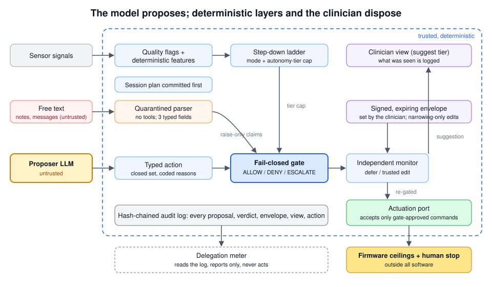

# BTH governance layer and simulator

> **BTH is a research prototype, not a medical device.**

How to put a language model inside a closed-loop clinical wearable without giving it authority.

**Status: simulated data only. No patients, no hardware, no real LLM.** The proposer and the free-text
parser are deterministic mocks. Every result in this repository is an existence demonstration from author-designed
tests, not an estimate of real-world performance.

The system as a whole (problem, hardware, status) is described in [bth-showcase](https://github.com/yasferaru/bth-showcase).

## What this is

BTH is a research prototype of a post-stroke elbow exosuit with physiological sensing. Its long-term design
includes a per-patient language model that watches sessions and suggests changes. This repository describes the
two pieces of work that come before any such model touches a patient:

1. **`llm_governance`**: a deterministic layer around the model. The model may only *propose*. Deterministic
   code, the clinician and the firmware *dispose*.
2. **`bth_sim`**: a seeded simulator of the sensors, the exosuit and the patient's physiology, used to test the
   governance layer and to check the documented design against itself, with pre-registered studies.

No source code is published here. The documents describe what was built, what was decided and why, what was
found, and what is not claimed.

## Architecture

The language model sits in one box, outside the trust boundary. Everything that measures, decides, limits or
logs is deterministic. Details: [docs/04_architecture.md](docs/04_architecture.md).

## Ten key decisions

| # | Decision | Reason in one line |
|---|---|---|
| 1 | The model's only output is one typed action from a closed set, with coded reasons and no prose | No free text can reach actuation |
| 2 | The authorisation gate fails closed: unknown, unparseable, out of range or erroring means DENY | "Unknown" must never mean "allowed" |
| 3 | Clinician instructions can narrow the envelope, never widen it, and never certify an action as safe | Models comply with illogical instructions; confirmation is not evidence |
| 4 | Free text goes only to a quarantined parser with no tools; claims from notes can only raise caution | Notes are an injection channel |
| 5 | The independent monitor sees actions and signals, never the model's reasoning | Stated reasoning is not a reliable window into behaviour |
| 6 | The default autonomy tier is observe-only, and live use is refused while any prerequisite is open | Autonomy has to be earned, not assumed |
| 7 | "Recommend pause" alerts and freezes model-initiated changes; only the deterministic watchdog and the human stop can pause the motors | Actuation authority stays deterministic, even in the safe direction |
| 8 | The model version comes from provider metadata and is pinned; a mismatch is a denial | Silent upgrades change behaviour |
| 9 | Every numeric value is registered with its source and status; any placeholder blocks live use | No invented numbers |
| 10 | The delegation meter reports only; patient outcomes are primary, clinician time saved is secondary | Optimising time saved invites over-delegation |

## Documents

| Doc | Content |
|---|---|
| [01 Problem and principle](docs/01_problem_and_principle.md) | Why a model in a closed loop at all; "proposes vs disposes"; delegation creep; accountability |
| [02 Threat model](docs/02_threat_model.md) | What can go wrong, mapped to controls, with residual risk |
| [03 Control families A-F](docs/03_control_families.md) | Each control: what, why, evidence level, what was built, how it is tested |
| [04 Architecture](docs/04_architecture.md) | Typed actions, gate, step-down ladder, monitor, audit log, parser, change control, meter |
| [05 Simulator and credibility](docs/05_simulator_and_credibility.md) | bth_sim, source precedence, pre-registrations, the beat-timing bug, two design studies |
| [06 Results](docs/06_results.md) | Campaign results with n, what they show and what they do not |
| [07 Datasets and licences](docs/07_datasets_and_licences.md) | Every dataset used, its licence and its role. Nothing is redistributed |
| [08 Not validated](docs/08_not_validated.md) | Every placeholder, unvalidated value and open question |

## What is not claimed

- No clinical validity, safety or benefit. Simulation cannot establish patient safety.
- No claim about how often these defences would stop errors from a real model, real patients or a motivated
  attacker. The same author wrote the planted errors, the gate, the monitor rules and the simulator.
- No claim that the simulator is realistic. It reached credibility level L0 (verified against its own
  specification) and did not reach L1 or L2 against public human data.

## Author

Yasmyna Feraru. GitHub [@yasferaru](https://github.com/yasferaru).
