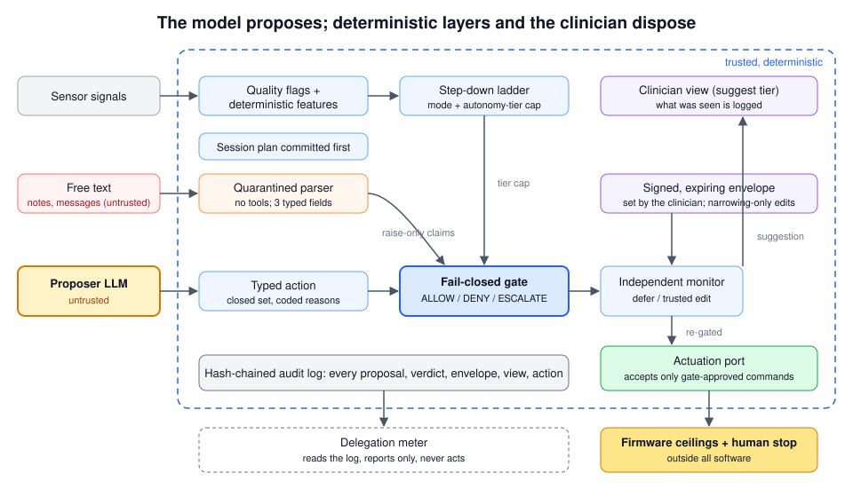
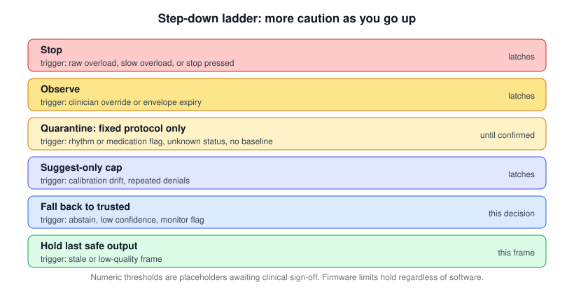

# 4. Architecture

> **BTH is a research prototype, not a medical device.**



The governance package is isolated: it imports nothing from the BTH backend, frontend or simulator, nothing
there imports it, and it reaches the rest of the system only through four narrow ports (signals in, clinician
in/out, patient channel out, actuation out). An architecture test enforces the isolation.

The pseudocode below is illustrative. It shows the shape of each interface, not the implementation.

## 4.1 Typed action space

The proposer's only output is a proposal:

```
Proposal:
    action        one of { hold, set stiffness, recommend pause, request clinician, abstain }
    value         number or none            # only for "set stiffness"
    reason        coded enum                # never prose
    premise       coded enum                # what the model claims is true; checked deterministically
    confidence    0..1
    (no other fields allowed)
```

There is no free-text field, so there is nothing for prose to hide in. Extra fields are rejected, not ignored.
Abstaining is a first-class action, so "I do not know" never has to be disguised as a guess. Actions beyond the
core five exist in the schema but are disabled, because no part of the system can carry them out safely yet.

## 4.2 The authorisation gate (fail closed)

```
authorise(model output, envelope, current frame, state, time) -> ALLOW | DENY | ESCALATE:
    parse the output into a proposal          else DENY
    version from provider metadata == pinned  else DENY
    envelope signature valid and not expired  else DENY
    session plan permits this action          else DENY
    frame fresh and of acceptable quality     else ESCALATE
    confidence above the envelope floor       else ESCALATE
    premise consistent with deterministic predicates   else DENY
    value inside (envelope ∩ firmware ceilings ∩ per-patient caps)   else DENY
    rate of change inside the slew limit      else DENY
    any exception anywhere                    -> DENY
    otherwise                                 -> ALLOW
    every call is written to the audit log, whatever the verdict
```

Two overrides sit beside the gate and can only push toward caution:

- in severe overload, a non-escalating proposal is replaced with a pause recommendation;
- a patient report of exhaustion, rest or pain escalates on its own (pause recommendation plus a clinician
  request). The monitor cannot suppress it.

An approved proposal becomes an approved-command token that only the gate can issue. The actuation port accepts
nothing else.

## 4.3 Step-down ladder

The ladder sets the operating mode and the highest autonomy tier allowed, frame by frame. Its rows follow the
controls document; the numeric thresholds are placeholders awaiting clinical sign-off
([08_not_validated.md](08_not_validated.md)).



| Trigger | Behaviour | How long it lasts |
|---|---|---|
| Frame stale or of low quality | Hold the last safe output; escalate; no model action | Per frame |
| Model abstains, or confidence below the floor | Fall back to the fixed protocol | Per decision |
| Independent monitor flags the action | Defer to the trusted fallback, or edit to the nearest safe value | Per decision |
| Calibration or drift alarm | Cap the tier at suggest | Latches until a signed clinician action |
| Rhythm or medication flag, or unknown status | Quarantine: fixed protocol only, state index in shadow | Until a clinician confirms status |
| Clinician override, or envelope expiry | Return to observe | Latches until a signed clinician action |
| Raw overload bound, slow overload, or stop pressed | Stop. Firmware limits hold regardless of software | Latches until a signed clinician action |
| No baseline yet (extension) | Fixed protocol only | Until enough samples |
| Repeated denials in a row (extension) | Cap the tier at suggest | Latches |

"Recommend pause" means: alert patient and clinician, and freeze every model-initiated change. It does **not**
pause the motors. If the clinician does not acknowledge within a set time, control falls to the fixed protocol,
never back to the model. Only the deterministic watchdog and the human stop can pause assistance.

## 4.4 Independent monitor

```
monitor(proposal, frame features, envelope) -> suspicion 0..1
    # inputs: the proposed action and deterministic features
    # never: the model's reasoning, prompt or memory
    rules score known-bad patterns (e.g. making assistance harder while fatigue indicators are high)
    above the defer threshold: defer to the fixed protocol, or edit to the nearest safe value
```

In the suggest tier, the monitor screens a suggestion **before** the clinician sees it. A suggestion the
clinician accepts is re-gated before it reaches the actuation port, because time has passed and the frame has
changed.

The monitor is rule-based on purpose. A second model as monitor would bring back the problems the monitor is
there to catch. The rule weights were chosen by the same author who wrote the planted errors; see the limits in
[06_results.md](06_results.md).

## 4.5 Hash-chained audit log

```
entry n = { decision id, time, kind, digest of the payload, fault tags, hash of entry n-1 }
hash(entry n) = SHA-256 of its canonical form
verify the chain -> first broken link, or OK
```

Every proposal, verdict, envelope change, model change, clinician view and clinician action is logged. A
suggestion is logged even when it was ignored or never shown. Fault-taxonomy tags (input fault, proposal
outside envelope, gate or monitor failure, clinician accepted without verification, patient factor, hardware)
are attached at write time, to support blinded adjudication later. Redaction for data protection replaces a
payload with its digest and keeps the chain valid. What may be logged at all is governed by a data-policy
allowlist.

Known limit: a chain proves integrity relative to its head. The head has to be anchored outside the system
(for example a periodic signed checkpoint) to detect truncation.

## 4.6 Quarantined parser

```
parse a note -> { pain level or none, fatigue level or none, intent code or none }
    # separate model, no tools, one item per call, input length capped
    # output validated to exactly these three typed fields
```

The parser never sees the plan or the envelope, and the proposer never sees the raw text. Its fields are treated
as **untrusted claims that can only raise caution**: a note can make the system more careful, never less. A
deterministic raising-only scan of the raw note runs in parallel, so a manipulated parser cannot hide a real
report of pain. Lowering caution requires structured input from the patient interface or the clinician.

## 4.7 Change control

Adapting to the individual patient is treated as a model change, not as a side effect:

- the model version is pinned in a registry and in each envelope;
- a candidate adaptation runs **silently in shadow** on live frames and is promoted only if it meets
  pre-specified criteria on held-out data;
- promotion needs a signed approval;
- allowed change types and acceptance criteria follow the structure of a predetermined change control plan
  (FDA guidance, 2024). The content of that plan is pending the clinician and a regulatory owner.

## 4.8 Delegation meter

Reads the audit log. Computes, per clinical situation and per decision type:

- share of suggestions accepted unchanged, and time to accept;
- override rate;
- verification steps taken before accepting;
- catch rate on planted errors (in simulation or training);
- share of decision steps initiated by the model versus the clinician;
- envelope renewals;
- clinician time saved, as a **secondary** figure only.

The meter has no write path to anything that acts. Whether seeing the meter's report itself changes delegation
is logged and can be tested.

## 4.9 Readiness gate

The system defaults to live mode and **refuses to start** while any prerequisite for human use is open or any
numeric value is still a placeholder. Today only explicit simulation runs are possible. The open prerequisites
are listed in [08_not_validated.md](08_not_validated.md).
