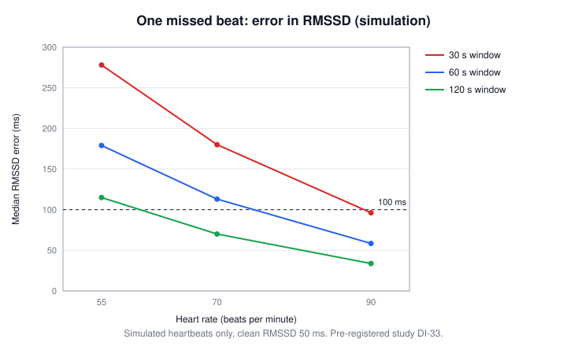

# 5. Simulator and credibility

> **BTH is a research prototype, not a medical device.**

## 5.1 What bth_sim is

A self-contained, seeded simulator of BTH sensor data, the exosuit loop and the patient's physiology. It has:

- a hidden (latent) state per simulated subject: load, effort, fatigue, autonomic tone, and the protocol phase;
- a population layer with per-subject random effects, so a "cohort" is a draw, not one average person;
- physiology models for skin conductance, heartbeat timing and heart rate variability, respiration, skin
  temperature, muscle activity and arm kinematics;
- sensor models (front-end noise, quantisation, interference, a chest-strap heartbeat sensor);
- labelled, seeded fault injectors (dropout, flatline, saturation, drift, missed and extra beats, stale data);
- a closed-loop engine that runs a session against the exosuit's control loop.

It is the single simulator new BTH work targets, and it is isolated from the backend and the governance package
(an architecture test enforces this). Where it needs a backend formula, it re-implements it from the design
documents and tests the copy against the documented values.

## 5.2 Seeded sub-streams

Every random draw comes from a named sub-stream of one seeded generator: one stream for physiology, one per
fault type, one for sensor noise, and so on. Adding a fault therefore never changes the physiology draws, and a
result with a fault can be compared with the same subject without it. There is no wall clock and no global
state: time is simulated, and every run is reproducible from its seed.

## 5.3 Source precedence

When sources disagree, a fixed order decides, and the disagreement is written down:

1. the internal hardware and software ground-truth documents;
2. the state-index design document;
3. the safety controls document (for faults and stress tests);
4. the backend code;
5. literature and datasets.

Rules that go with it:

- Re-read the ground-truth documents before using or changing any parameter.
- Never copy a number from old code without checking it against the documents.
- A contradiction **inside** a ground-truth document is resolved by the value best supported by the literature,
  with the source and a confidence note, and both values are kept on record.
- A value marked "to be validated" stays the default and is flagged as an unvalidated prior.
- Anything no source covers is a guess, and guesses are **randomised**, never fixed constants.

## 5.4 Discrepancy log

Every disagreement goes into a numbered log: item, source A, source B, value used, reason, and whether the
document owner must decide. The log has 78 entries. Three examples of the kind of thing it catches:

- **D58, beat timing** (below): the code contradicted its own documentation.
- **D61, meaning of "low stiffness"**: one design document reads low stiffness as "full assist", while the
  physical impedance law makes low stiffness *more compliant*, with less corrective torque. The owner chose an
  interpretation for the study, and the study tested both plant hypotheses.
- **D62, slew limit**: the controls document requires a rate limit, but no document gives a value. It became a
  parameter and was swept rather than chosen.

## 5.5 Credibility ladder

Credibility is judged **per claim**, never as one score.

| Level | Meaning |
|---|---|
| L0 | Verified code and provenance: formulas equal the design documents; analytic test cases; every parameter has a recorded source and confidence; seeded and reproducible |
| L1 | Matches public data from **healthy** people |
| L2 | Matches public data from **post-stroke** people |
| L3 | Matches our own healthy-volunteer exosuit sessions (none exist) |
| L4 | Matches clinic patient data (none exists) |

A level is reached for a sub-claim only if **all** pre-registered tests for it pass on held-out subjects. A
missing dataset means "not reached", never "passed".

| Claim | Level reached | Why |
|---|---|---|
| A. Governance logic behaves as specified on planted situations | **L0** | Fault signatures follow the design documents and the stress tests reproduce the controls document. Realism of the faults against real faulty recordings is untested: no labelled real fault data exists |
| B. Comparisons between state-index variants transfer to people | **L0 only** | Decision-level agreement and ranking tests on public data did not pass |
| C. Patient safety | **Not supported by simulation**, by design | |

Signal level: every signal reached L0. **None reached L1 or L2.** On the open movement datasets (U-Limb,
SciData 2025, Zenodo 3713449), none of the pre-registered kinematic tests (0 of 15) and none of the muscle-
activity tests (0 of 14) passed, at either level. Some failed as "different", others as "inconclusive" because the
held-out sets were small. The report names the reasons: task mismatch between datasets and the simulated
protocol, small held-out sets, simulated movement that is smoother than real movement, and skin-conductance
dynamics. Autonomic signals were tested against a restricted-licence dataset; they did not reach L1, and those
results are not reproduced here.

**Showing this honestly is a result.** A simulator that passed every test on its first run would deserve less
trust, not more.

## 5.6 Pre-registrations

Each study was written down before it was run, and the file was hashed. Changing a rule after seeing results
requires a new, dated file; the old one stays. The hashes below were recomputed on 15 November 2026 and match the
stored values.

| # | Study | SHA-256 |
|---|---|---|
| 1 | Credibility margins (all signals) | `47ba3275b2d1b78db9671d15e4448cabf323f3d37702296779be56536a5af378` |
| 2 | Addendum for one dataset, written before any of its features were computed | `1eb33660ed06b1c8e74f6005171be7b729848979d1afdcf680a4ecb1a66a79e8` |
| 3 | Live heartbeat-artefact handling | `ebc3f4b6ddeca2e5ae63dd16a7f9e37f9c167e64cf9273e7a09027b1f077b35b` |
| 4 | State index and watchdog false aborts | `c631c7d53edd325b2fe2e928ccf6888fc111b3765f262b75383dedc9dfed3915` |
| 5 | Assistance-modulation policy | `030233b690ba4289d8580a9e107bc5a27db96a1b0b8a344587ec12d38a379a09` |
| 6 | Working values and flagged-patient variants | `70908b6b38e02f342f5c4073901e647128838b1b2d0e435e854bf6a5de1826bc` |

The files themselves are not published here. The hashes let a reader check later that a file shown to them is
the one written before the results.

## 5.7 The beat-timing bug (DI-33)

The heart model's documentation said each heartbeat is stamped at the R peak that **ends** its RR interval. The
code stamped the **start**. Nothing failed: the simulator ran, the tests passed.

The DI-33 study exposed it. On fault-free data, the "raw" (unedited) heart-rate-variability measure should equal
the truth exactly. It was off by tens of milliseconds, which is impossible on clean data. The bug was fixed, a
regression test was added, and **every earlier validation run was marked superseded**. In the same step, the
clean reference was restricted to normal sinus beats, with the simulator's own ectopic beats switched off in the
clean cohort and injected only as faults. Neither change touched a pre-registered rule.

What the study then showed, in simulation: a single missed beat moves a 60 s RMSSD window by more than 100 ms at
70 beats per minute. The error grows as heart rate falls and as the window shortens. That is larger than the
whole difference between rest and overload in the documented design, so live heart-rate variability needs
artefact handling and quality gating before it can drive anything.

## 5.8 State index and watchdog: the false-abort trade-off (DI-36)

The documented design aborts a session when a physiological state index stays above an overload boundary for a
set time. The study replayed the documented configuration and a pre-registered grid of variants on 100 held-out
simulated subjects per arm, choosing variants on a separate tuning set.

What it found, in simulation:

- The documented configuration produced **at least one false abort in every simulated subject** at rest-level
  physiology (share 1.00, 95% CI 0.96 to 1.00), while detecting all true overloads. An alarm that is always on
  detects everything and means nothing.
- The documented index **cannot reach its own documented resting target** in steady state; the resting target and
  the formula disagree.
- The documented ramp target ends at the overload boundary, so the documented system cannot tell late challenge
  from overload, by design.
- Of every single factor tested, only an **independent raw-signal second check** before an abort moved false
  aborts materially (it removed about a quarter of them). Window length, robust statistics, hysteresis and model
  choice did not.
- The best variant still false-aborted in roughly 70% of simulated subjects.

Conclusion stated in the study: **do not adopt any variant on simulation evidence.** Collect labelled real
sessions first. The variant definitions and the index itself are not published.

## 5.9 Assistance-modulation policy (DI-13)

The question: when should the exosuit change how much it assists, based on the patient's physiological state?
Five policies were compared across seven scenarios and two hypotheses about how the patient responds, with 30
simulated subjects per cell.

What it found, in simulation:

- Modulating from the state index **alone** triggered in every simulated subject in scenarios where arousal rose
  without any physical strain (boredom-level noise, speech, sensor artefacts, emotional arousal).
- Requiring corroborating evidence before modulating suppressed those triggers while still responding to true
  overload. **That separation is partly by construction**: in the reduced model, strain indicators depend only on
  task demand, fatigue and stiffness. Real muscle activity rises with anxiety too.
- **Whether reducing stiffness helps or harms flips with the plant hypothesis.** Under one hypothesis it protects
  the patient; under the other it reduces the recovery stimulus. The simulation cannot say which is true.
- All commands stayed within bounds, oscillation stayed low, and there was no runaway.

What a trial would have to measure is written down for both hypotheses. Any randomisation of modulation direction
is blocked until ethics approval and a risk analysis exist.

## 5.10 Working values (SIM_4)

The governance layer uses proposed per-joint torque and speed ceilings, labelled NEW_UNVALIDATED. The simulator
checked them against its own generated movements: **the proposed ceilings would clip a large share of normal
simulated movement**, at both joints. They are therefore not adoptable as they stand. Real ceilings need the motor
datasheet and measured joint speeds.
